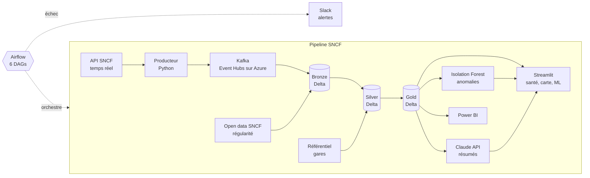

# Pipeline de Streaming Temps Réel SNCF

**Documentation en ligne** : https://bipanda93.github.io/sncf-streaming-pipeline/ (architecture, décisions, incidents, CI/CD, journal de projet)

Architecture data engineering cloud-native pour l'ingestion, le traitement et la restitution des perturbations ferroviaires SNCF en temps réel, avec historique de régularité et détection d'anomalies.

**Auteur** : Bipanda Franck Ulrich — Mastère Data Engineering, Digital School de Paris

---

## Vue d'ensemble

Ce projet ingère en continu les données de perturbations du réseau SNCF (API Navitia), les traite via une architecture medallion (Bronze/Silver/Gold), et les restitue dans un dashboard Power BI interactif à 4 pages et dans un tableau de bord Streamlit (santé des données, carte des gares touchées, résumés générés par Claude). Il combine streaming temps réel (Kafka) et historique batch (données de régularité 2013-2026) dans une même architecture.

## Chiffres clés

- 166 917 événements ingérés en continu (Bronze)
- 17 778 perturbations distinctes après dédoublonnage (Silver)
- 21 814 lignes d'historique de régularité (2013-2026)
- 6 DAGs Airflow, validés sur Docker Compose puis déployés sur Kubernetes (AKS)
- 9 modules Terraform : déploiement réel sur Azure le 10/09/2026, puis destruction de 37 ressources le 14/09/2026 pour limiter les coûts
- 8 contrôles CI obligatoires sur `main`, 19 tests unitaires hors DAGs

## Architecture

Les données arrivent de l'API SNCF (temps réel) et de l'open data (historique), passent par Kafka puis par les trois couches Delta Bronze, Silver et Gold. Le Gold alimente Power BI, Streamlit, l'Isolation Forest et les résumés Claude. Airflow orchestre l'ensemble et prévient Slack en cas d'échec. Le détail des outils est sur la page [Outils et flux](https://bipanda93.github.io/sncf-streaming-pipeline/outils/).

Architecture medallion complète, avec une table de pont (bridge table) pour gérer les relations multi-valeurs (une perturbation touche souvent plusieurs régions et gares à la fois). Diagramme détaillé : docs/schema_donnees.md

## Stack technique

| Couche | Outils |
|---|---|
| Ingestion | Kafka, Python |
| Traitement | PySpark, Delta Lake |
| Orchestration | Apache Airflow (6 DAGs), Docker Compose en local, AKS via Helm (KubernetesExecutor) validé puis détruit |
| Infrastructure | Terraform, Azure (Event Hubs, Databricks, AKS, ADLS Gen2, Container Registry), déployée une fois pour validation puis détruite |
| Monitoring | Prometheus + Grafana (kube-prometheus-stack, local au cluster) |
| Restitution | Power BI (architecture double : Fabric Direct Lake + Desktop Import), tableau de bord Streamlit (carte pydeck) |
| IA | Isolation Forest (détection d'anomalies), Claude API (enrichissement) |
| Documentation | MkDocs Material, publiée sur GitHub Pages à chaque fusion dans `main` |
| CI/CD | GitHub Actions (8 contrôles : lint, tests unitaires, tests des DAGs, scan de secrets, validation Terraform et Compose, build Docker, build du site de documentation), Dependabot, contrôles obligatoires sur main |

## Intégration continue

Chaque pull request vers `main` lance huit contrôles (`.github/workflows/ci.yml`), tous obligatoires pour fusionner (ruleset sur `main`, sans contournement possible) :

- **dag-tests** : les 6 DAGs Airflow se chargent sans erreur, un DAG par fichier, identifiants uniques (Airflow 3.3.2, comme l'image de production) ;
- **unit-tests** : tests unitaires du client SNCF (mode mock, erreurs HTTP, pagination) et du producteur Kafka (enveloppe, clé, flush), sans réseau ni broker ;
- **lint** : analyse statique du code Python avec ruff ;
- **secret-scan** : recherche de secrets dans les commits avec Gitleaks ;
- **terraform-validate** : formatage et validation de la configuration Terraform, sans connexion à Azure ;
- **compose-validate** : validation de `docker-compose.yml` ;
- **docker-build** : construction de l'image Airflow et vérification de Java 17, PySpark, Delta et Airflow à l'intérieur ;
- **docs-build** : construction stricte du site de documentation (MkDocs), publié sur GitHub Pages après chaque fusion.

Dependabot propose chaque semaine les mises à jour des dépendances Python, des actions GitHub, de l'image Docker et de Terraform.

Aucun contrôle ne dépend d'Azure, de Kafka ou de l'API SNCF, et aucun secret n'est à configurer : la CI tourne sur GitHub seul.

Le déploiement Terraform (`deploy.yml`) se limite à un plan déclenché manuellement : le state Terraform étant local, `apply` et `destroy` ne se font que depuis le poste de travail (voir `notes/decisions_architecture.md`, 2026-10-21).

## Orchestration Airflow

6 DAGs, validés sur Docker Compose en local et sur Kubernetes (AKS) avant la destruction de l'infra :
- ingestion_bronze_temps_reel : ingestion Kafka vers Bronze, horaire
- silver_gold_temps_reel : Silver vers Gold vers export Power BI, toutes les 4h
- historique_mensuel : chargement de l'historique de régularité
- enrichissement_llm_mensuel : enrichissement via Claude API
- gouvernance_rgpd : politique de rétention et traçabilité
- pipeline_complet_manuel : exécution manuelle de bout en bout

## Dashboard Power BI

4 pages, style visuel aligné sur le site de documentation (fond de nuit, panneaux sombres, accent doré), rapport en cours de finalisation :
1. Vue d'ensemble : KPI temps réel (perturbations actives, durée moyenne, régions touchées, moyenne journalière)
2. Régions et gares : carte et tableau de détail par région (perturbations, gares touchées, moyennes par jour)
3. Types de perturbations : matrice région x effet avec priorité moyenne, répartition par niveau d'alerte
4. Ponctualité : KPI par type de transport, ponctualité par année, écart des régions TER à la moyenne, taux d'annulation

Détail du modèle, des mesures et des pièges : page [Rapport Power BI](https://bipanda93.github.io/sncf-streaming-pipeline/rapport_powerbi/).

Modélisation DAX avancée, notamment le pattern TREATAS pour filtrer entre tables sans relation physique directe (nécessaire car une perturbation peut toucher plusieurs régions/gares simultanément).

## Tableau de bord Streamlit

Trois onglets, avec un thème visuel aligné sur le site de documentation :
1. Santé des données : fraîcheur, volume et qualité de chaque table Delta (Bronze, Silver, Gold).
2. Carte : gares touchées par les perturbations actives, colorées par niveau d'alerte, avec infobulle. Les arrêts sont localisés par jointure sur le code UIC avec le référentiel SNCF « gares voyageurs » (`reference/gares_voyageurs.csv`, 2950 gares) : 92 % des arrêts sont retrouvés, les cars et les gares étrangères n'y figurent pas.
3. ML et LLM : résumés mensuels générés par l'API Claude ; l'Isolation Forest attend un historique suffisant.

Il montre les données du dernier lancement du pipeline, pas un service permanent.

## Défis techniques résolus

- Corruption de checkpoint Kafka après arrêt brutal, diagnostiquée et résolue
- Perte silencieuse de données via /tmp non persistant, corrigée
- Conflits de transaction Delta Lake liés à la concurrence des DAGs
- Audit qualité de données : détection d'un mélange de 3 granularités géographiques dans l'historique de ponctualité, quantification d'un risque de double comptage (~18% sur l'échantillon testé), corrigé par filtrage explicite
- Incident de sécurité : exposition accidentelle d'un secret Azure dans un commit, révoqué immédiatement et documenté
- Migration Kafka vers Azure Event Hubs : clé d'authentification en écriture confondue avec la clé en lecture seule (erreur TOPIC_AUTHORIZATION_FAILED), diagnostiquée et corrigée en séparant les deux usages dans la configuration
- CI/CD Terraform : deux outils locaux conteneurisés (Azure CLI et Terraform) reposant sur des mécanismes de credentials distincts, source d'une confusion de diagnostic résolue en clarifiant l'architecture d'outillage locale
- Déploiement Airflow sur Kubernetes (AKS) : identités managées mal ciblées (identité du plan de contrôle du cluster au lieu de celle des nœuds), accès Key Vault corrigé en conséquence ; volumes de logs persistants bloqués par une classe de stockage incompatible (ReadWriteMany), résolu en ciblant explicitement la classe adaptée
- Environnement : pandas 3 et PySpark 4.1 incompatibles sur la conversion des timestamps (`toPandas()`), pandas épinglé sous la version 3 et colonnes timestamp converties en texte
- Secret expiré : clé API Claude refusée (erreur 401) sans alerte préalable, et conteneur Airflow qui gardait l'ancienne version des dépendances après fusion d'une mise à jour : reconstruction de l'image et vérification des versions dans le conteneur
- Monitoring Kubernetes : crashs de pod diagnostiqués à tort comme un problème mémoire, cause réelle identifiée via l'historique des événements Kubernetes (contrôles de santé trop stricts pour un nœud sous contention CPU)

Détail complet de chaque incident : dossier notes/

## Décisions d'architecture documentées

Chaque choix structurant est justifié et tracé dans notes/decisions_architecture.md, notamment le choix d'une architecture double Power BI, l'usage de tables de pont plutôt qu'un schéma en étoile classique, le choix de TREATAS plutôt qu'une relation bidirectionnelle en DAX, et les choix d'architecture Kubernetes (exécuteur, distribution des DAGs, gestion des identités Azure). Le déploiement continu est la limite assumée du sujet, pour une raison de coût ; deux voies restent ouvertes (continuer sur Azure ou déployer sur un serveur privé), comparées dans la page « Deux voies de déploiement » du site de documentation.

## Limites connues

- Databricks : infrastructure créée (workspace, connecteur d'accès), mais jamais mise en service — accès bloqué, probable restriction de consentement au niveau du tenant Azure de l'école
- Monitoring Azure Managed Grafana (natif Azure) : accessible mais sans métriques AKS en direct, lien complet non implémenté — supplanté par un monitoring local (Prometheus + Grafana sur AKS), pleinement fonctionnel
- Isolation Forest pas encore entraîné (50 à 100 exécutions du flux temps réel nécessaires, qu'Airflow sous Docker Compose peut produire)
- Aucun déploiement continu : `deploy.yml` se limite à un plan Terraform manuel, le state étant local ; l'infrastructure Azure a été détruite après validation
- La CI ne vérifie pas l'exécution de Spark, de Delta ni de l'API Claude : les montées de version de ces dépendances se testent en local
- Certains sous-réseaux TER historiques nécessitent encore une correspondance fine vers les régions actuelles

## Lancer le projet

1. Copier `.env.example` vers `.env` et le remplir (token SNCF, Kafka, clé `ANTHROPIC_API_KEY` pour l'enrichissement ; sans clé, les clients passent en mode simulé).
2. Démarrer Kafka, Kafka UI et Airflow : `docker compose up -d` (Airflow sur http://localhost:8081).
3. Tableau de bord : installer `requirements.txt` dans un environnement Python 3.12 avec Java 17, puis `streamlit run src/dashboard_streamlit.py`.
4. Tests : `python -m pytest tests --ignore=tests/test_dags.py` (les tests des DAGs exigent Airflow et tournent en CI).
5. Documentation : `pip install -r requirements-docs.txt` puis `mkdocs serve`.

Après une mise à jour des dépendances, reconstruire l'image Airflow (`docker compose build airflow`).
