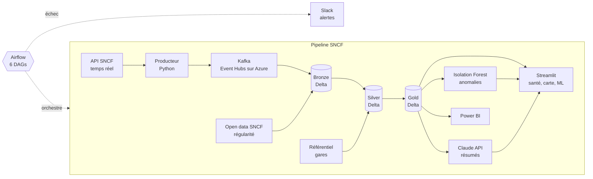
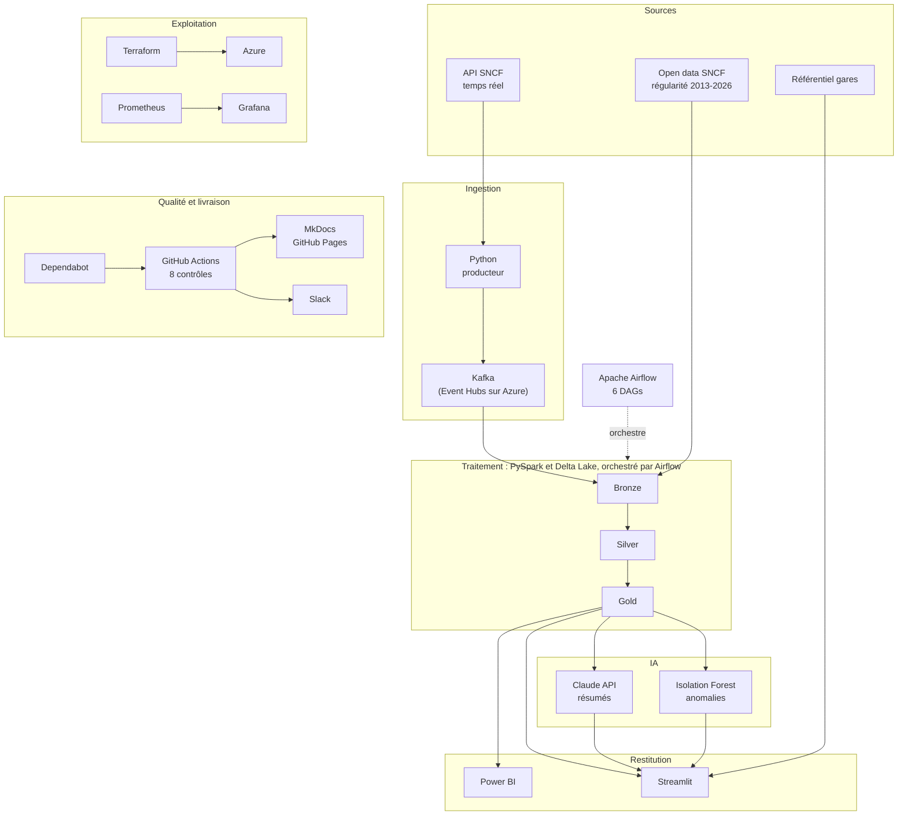

# Outils et flux

## Architecture

Les données arrivent de l'API SNCF (temps réel) et de l'open data (historique), passent par Kafka puis par les trois couches Delta Bronze, Silver et Gold. Le Gold alimente Power BI, Streamlit, l'Isolation Forest et les résumés Claude. Airflow orchestre l'ensemble et prévient Slack en cas d'échec.

## Outils utilisés

Vue d'ensemble des outils et de leur place dans le pipeline.

Lecture du schéma : les sources alimentent Kafka (Event Hubs sur Azure) puis la chaîne Bronze, Silver, Gold de PySpark et Delta Lake, orchestrée par Airflow. Power BI et Streamlit restituent les résultats ; Claude produit les résumés mensuels et l'Isolation Forest détecte les anomalies sur les métriques d'exécution. Terraform décrit l'infrastructure Azure (déployée une fois puis détruite), Prometheus et Grafana surveillent l'infrastructure, et GitHub Actions, Dependabot, Slack et MkDocs assurent la qualité et la livraison.
